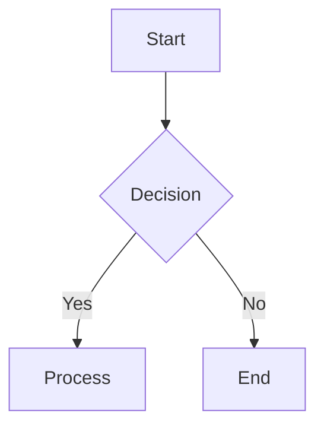
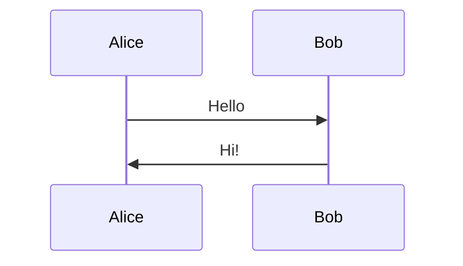
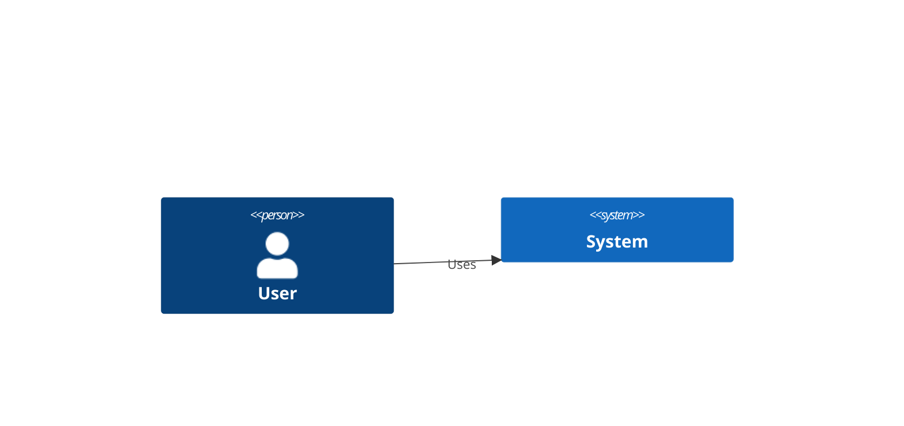
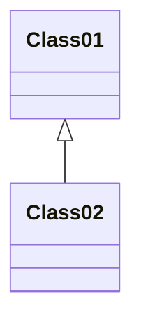

# Phase 2: Mermaid Output Support

## Goals

Add Mermaid diagram generation as the first new output format after the IR refactoring.

**Why Mermaid First:**
- Widely used in GitHub, GitLab, Markdown
- Simpler syntax than PlantUML
- Good for flowcharts, sequence diagrams, C4
- Complements PlantUML nicely

## Mermaid Format Overview

### Supported Diagram Types

**1. Flowchart**


**2. Sequence Diagram**


**3. C4 Diagram (via c4-diagram)**


**4. Class Diagram**


## Technical Implementation

### Mermaid Generator

```python
# diacea/generators/mermaid.py

from __future__ import annotations

from diacea.generators.base import BaseGenerator
from diacea.ir import Diagram, Shape, Connection, ShapeType, ConnectionType
from diacea.ir.semantic import SemanticType

class MermaidGenerator(BaseGenerator):
    """Generate Mermaid diagrams from IR."""

    def __init__(self, diagram_type: str = 'auto'):
        """
        Initialize Mermaid generator.

        Args:
            diagram_type: 'flowchart', 'c4', 'sequence', or 'auto'
        """
        self.diagram_type = diagram_type

    @property
    def format_name(self) -> str:
        return 'mermaid'

    def generate(self, diagram: Diagram) -> str:
        """Generate Mermaid from IR."""
        # Auto-detect diagram type if needed
        if self.diagram_type == 'auto':
            detected_type = self._detect_diagram_type(diagram)
        else:
            detected_type = self.diagram_type

        # Dispatch to specific generator
        if detected_type == 'c4':
            return self._generate_c4(diagram)
        elif detected_type == 'sequence':
            return self._generate_sequence(diagram)
        else:
            return self._generate_flowchart(diagram)

    def _detect_diagram_type(self, diagram: Diagram) -> str:
        """Auto-detect diagram type from IR."""
        shapes = diagram.get_shapes()
        connections = diagram.get_connections()

        # Check for C4 semantic types
        c4_types = {SemanticType.SYSTEM, SemanticType.PERSON,
                    SemanticType.CONTAINER, SemanticType.DATABASE}
        has_c4 = any(
            shape.semantic_type and SemanticType(shape.semantic_type) in c4_types
            for shape in shapes
        )
        if has_c4:
            return 'c4'

        # Check for sequence diagram patterns
        # (multiple connections between same elements, lifeline-like structure)
        if len(connections) > len(shapes) * 1.5:
            return 'sequence'

        # Default to flowchart
        return 'flowchart'

    def _generate_flowchart(self, diagram: Diagram) -> str:
        """Generate flowchart Mermaid."""
        lines = ['flowchart TD']

        shapes = diagram.get_shapes()
        connections = diagram.get_connections()

        # Define nodes with appropriate shapes
        for shape in shapes:
            node_id = self._sanitize_id(shape.id)
            label = self._get_label(shape, diagram)

            # Map semantic types to Mermaid node shapes
            if shape.semantic_type == SemanticType.DECISION.value:
                lines.append(f'    {node_id}{{{label}}}')  # Diamond
            elif shape.semantic_type == SemanticType.START_END.value:
                lines.append(f'    {node_id}([{label}])')  # Stadium
            elif shape.semantic_type == SemanticType.DATABASE.value:
                lines.append(f'    {node_id}[({label})]')  # Cylinder
            elif shape.shape_type == ShapeType.DIAMOND:
                lines.append(f'    {node_id}{{{label}}}')
            elif shape.shape_type == ShapeType.CIRCLE:
                lines.append(f'    {node_id}(({label}))')
            else:
                lines.append(f'    {node_id}[{label}]')  # Rectangle

        # Define connections
        for conn in connections:
            from_id = self._sanitize_id(conn.from_id)
            to_id = self._sanitize_id(conn.to_id)
            label = conn.label or ''

            # Map connection types to Mermaid arrows
            if conn.connection_type == ConnectionType.BIDIRECTIONAL:
                arrow = '<-->'
            elif conn.connection_type == ConnectionType.LINE:
                arrow = '---'
            else:
                arrow = '-->'

            if label:
                lines.append(f'    {from_id} {arrow}|{label}| {to_id}')
            else:
                lines.append(f'    {from_id} {arrow} {to_id}')

        return '\n'.join(lines)

    def _generate_c4(self, diagram: Diagram) -> str:
        """Generate C4 Mermaid."""
        lines = ['C4Context']

        shapes = diagram.get_shapes()
        connections = diagram.get_connections()
        groups = diagram.get_groups()

        # Define people
        for shape in shapes:
            if shape.semantic_type == SemanticType.PERSON.value:
                node_id = self._sanitize_id(shape.id)
                label = self._get_label(shape, diagram)
                lines.append(f'    Person({node_id}, "{label}")')

        # Define systems and boundaries
        for group in groups:
            if group.semantic_type == SemanticType.SYSTEM_BOUNDARY.value:
                group_id = self._sanitize_id(group.id)
                label = self._get_label(group, diagram)
                lines.append(f'    System_Boundary({group_id}, "{label}") {{')

                # Add contained elements
                for child_id in group.children:
                    child = diagram.get_element(child_id)
                    if isinstance(child, Shape):
                        child_node_id = self._sanitize_id(child.id)
                        child_label = self._get_label(child, diagram)

                        if child.semantic_type == SemanticType.DATABASE.value:
                            lines.append(f'        ComponentDb({child_node_id}, "{child_label}")')
                        else:
                            lines.append(f'        Container({child_node_id}, "{child_label}")')

                lines.append('    }')

        # Standalone containers
        for shape in shapes:
            if (shape.semantic_type == SemanticType.CONTAINER.value
                and not self._is_in_group(shape.id, groups)):
                node_id = self._sanitize_id(shape.id)
                label = self._get_label(shape, diagram)
                lines.append(f'    Container({node_id}, "{label}")')

        # Relationships
        for conn in connections:
            from_id = self._sanitize_id(conn.from_id)
            to_id = self._sanitize_id(conn.to_id)
            label = conn.label or ''
            lines.append(f'    Rel({from_id}, {to_id}, "{label}")')

        return '\n'.join(lines)

    def _generate_sequence(self, diagram: Diagram) -> str:
        """Generate sequence diagram Mermaid."""
        lines = ['sequenceDiagram']

        connections = diagram.get_connections()

        # Group connections by participants
        participants = set()
        for conn in connections:
            participants.add(conn.from_id)
            participants.add(conn.to_id)

        # Define participants
        for participant_id in sorted(participants):
            elem = diagram.get_element(participant_id)
            if elem:
                label = self._get_label(elem, diagram)
                safe_id = self._sanitize_id(participant_id)
                lines.append(f'    participant {safe_id} as {label}')

        # Define messages
        for conn in connections:
            from_id = self._sanitize_id(conn.from_id)
            to_id = self._sanitize_id(conn.to_id)
            label = conn.label or ''

            if conn.connection_type == ConnectionType.BIDIRECTIONAL:
                lines.append(f'    {from_id}-->>{to_id}: {label}')
            else:
                lines.append(f'    {from_id}->>{to_id}: {label}')

        return '\n'.join(lines)

    def _get_label(self, element, diagram: Diagram) -> str:
        """Get label for element."""
        # Check for bound text
        for text in diagram.get_texts():
            if text.bound_to == element.id:
                return text.content

        # Fallback to semantic type or generic
        return element.metadata.get('label', 'Box')

    def _sanitize_id(self, element_id: str) -> str:
        """Sanitize ID for Mermaid (alphanumeric only)."""
        # Mermaid IDs must start with letter, contain only alphanumeric
        sanitized = ''.join(c for c in element_id if c.isalnum())
        if not sanitized[0].isalpha():
            sanitized = 'n' + sanitized
        return sanitized[:16]  # Keep it short

    def _is_in_group(self, element_id: str, groups: list) -> bool:
        """Check if element is in any group."""
        for group in groups:
            if element_id in group.children:
                return True
        return False
```

### CLI Integration

```python
# Update diacea/cli.py

parser.add_argument(
    '-f',
    '--format',
    default='c4',
    choices=['basic', 'c4', 'mermaid'],  # Add mermaid
    help='Output format (default: c4)',
)

# In main():
if args.format == 'mermaid':
    from diacea.generators.mermaid import MermaidGenerator
    generator = MermaidGenerator(diagram_type='auto')
    plantuml = generator.generate(ir_diagram)
```

## New Tests

### 1. Mermaid Generator Tests

```python
# tests/generators/test_mermaid_generator.py

def test_flowchart_basic():
    """Test basic flowchart generation."""
    diagram = Diagram()
    diagram.add_element(Shape(
        id='1',
        shape_type=ShapeType.RECTANGLE,
        position=Point(0, 0),
        size=Dimensions(100, 50),
    ))
    # ... add more elements

    gen = MermaidGenerator(diagram_type='flowchart')
    output = gen.generate(diagram)

    assert output.startswith('flowchart TD')
    assert '[Box]' in output

def test_flowchart_decision_diamond():
    """Test decision node renders as diamond."""
    shape = Shape(
        id='decision1',
        shape_type=ShapeType.DIAMOND,
        semantic_type=SemanticType.DECISION.value,
        position=Point(0, 0),
        size=Dimensions(100, 100),
    )
    diagram = Diagram(elements=[shape])

    gen = MermaidGenerator(diagram_type='flowchart')
    output = gen.generate(diagram)

    assert '{Decision}' in output  # Mermaid diamond syntax

def test_flowchart_connections():
    """Test connection rendering."""
    shape1 = Shape(id='1', shape_type=ShapeType.RECTANGLE,
                   position=Point(0, 0), size=Dimensions(100, 50))
    shape2 = Shape(id='2', shape_type=ShapeType.RECTANGLE,
                   position=Point(200, 0), size=Dimensions(100, 50))
    conn = Connection(
        id='c1',
        from_id='1',
        to_id='2',
        connection_type=ConnectionType.ARROW,
        position=Point(0, 0),
        size=Dimensions(0, 0),
        label='connects'
    )
    diagram = Diagram(elements=[shape1, shape2, conn])

    gen = MermaidGenerator(diagram_type='flowchart')
    output = gen.generate(diagram)

    assert '-->' in output
    assert '|connects|' in output

def test_c4_generation():
    """Test C4 diagram generation."""
    person = Shape(
        id='user',
        shape_type=ShapeType.DIAMOND,
        semantic_type=SemanticType.PERSON.value,
        position=Point(0, 0),
        size=Dimensions(100, 100),
    )
    system = Shape(
        id='sys',
        shape_type=ShapeType.RECTANGLE,
        semantic_type=SemanticType.CONTAINER.value,
        position=Point(200, 0),
        size=Dimensions(150, 100),
    )
    conn = Connection(
        id='c1',
        from_id='user',
        to_id='sys',
        connection_type=ConnectionType.ARROW,
        position=Point(0, 0),
        size=Dimensions(0, 0),
        label='uses'
    )
    diagram = Diagram(elements=[person, system, conn])

    gen = MermaidGenerator(diagram_type='c4')
    output = gen.generate(diagram)

    assert output.startswith('C4Context')
    assert 'Person(' in output
    assert 'Container(' in output
    assert 'Rel(' in output

def test_auto_detect_c4():
    """Test auto-detection of C4 diagrams."""
    person = Shape(
        id='user',
        shape_type=ShapeType.RECTANGLE,
        semantic_type=SemanticType.PERSON.value,
        position=Point(0, 0),
        size=Dimensions(100, 100),
    )
    diagram = Diagram(elements=[person])

    gen = MermaidGenerator(diagram_type='auto')
    output = gen.generate(diagram)

    assert output.startswith('C4Context')

def test_auto_detect_flowchart():
    """Test auto-detection defaults to flowchart."""
    shape = Shape(
        id='box',
        shape_type=ShapeType.RECTANGLE,
        position=Point(0, 0),
        size=Dimensions(100, 50),
    )
    diagram = Diagram(elements=[shape])

    gen = MermaidGenerator(diagram_type='auto')
    output = gen.generate(diagram)

    assert output.startswith('flowchart TD')

def test_sequence_diagram():
    """Test sequence diagram generation."""
    alice = Shape(id='alice', shape_type=ShapeType.RECTANGLE,
                  position=Point(0, 0), size=Dimensions(100, 50))
    bob = Shape(id='bob', shape_type=ShapeType.RECTANGLE,
                position=Point(200, 0), size=Dimensions(100, 50))
    msg = Connection(
        id='m1',
        from_id='alice',
        to_id='bob',
        connection_type=ConnectionType.ARROW,
        position=Point(0, 0),
        size=Dimensions(0, 0),
        label='Hello'
    )
    diagram = Diagram(elements=[alice, bob, msg])

    gen = MermaidGenerator(diagram_type='sequence')
    output = gen.generate(diagram)

    assert output.startswith('sequenceDiagram')
    assert 'participant' in output
    assert '>>' in output
    assert 'Hello' in output

def test_id_sanitization():
    """Test ID sanitization for Mermaid."""
    shape = Shape(
        id='box-with-dashes_123',
        shape_type=ShapeType.RECTANGLE,
        position=Point(0, 0),
        size=Dimensions(100, 50),
    )
    diagram = Diagram(elements=[shape])

    gen = MermaidGenerator(diagram_type='flowchart')
    output = gen.generate(diagram)

    # Should only contain alphanumeric
    assert 'boxwithdashes123' in output

def test_label_from_bound_text():
    """Test label extraction from bound text."""
    shape = Shape(id='s1', shape_type=ShapeType.RECTANGLE,
                  position=Point(0, 0), size=Dimensions(100, 50))
    text = Text(id='t1', content='My Label', bound_to='s1',
                position=Point(0, 0), size=Dimensions(0, 0))
    diagram = Diagram(elements=[shape, text])

    gen = MermaidGenerator(diagram_type='flowchart')
    output = gen.generate(diagram)

    assert 'My Label' in output
```

### 2. Integration Tests

```python
# tests/test_integration_mermaid.py

def test_excalidraw_to_mermaid():
    """Test full pipeline: Excalidraw → IR → Mermaid."""
    from diacea.parsers.excalidraw import ExcalidrawParser
    from diacea.generators.mermaid import MermaidGenerator

    excalidraw_data = {
        'elements': [
            {'id': '1', 'type': 'rectangle', 'x': 0, 'y': 0,
             'width': 100, 'height': 50},
            {'id': '2', 'type': 'rectangle', 'x': 200, 'y': 0,
             'width': 100, 'height': 50},
            {'id': 'a1', 'type': 'arrow', 'startBinding': {'elementId': '1'},
             'endBinding': {'elementId': '2'}, 'points': [[0, 0], [200, 0]]}
        ]
    }

    parser = ExcalidrawParser()
    diagram = parser.parse(excalidraw_data)

    gen = MermaidGenerator()
    output = gen.generate(diagram)

    assert 'flowchart' in output
    assert '-->' in output
```

### 3. CLI Tests

```python
# tests/test_cli_mermaid.py

def test_cli_mermaid_format(tmp_path):
    """Test CLI with Mermaid output."""
    from diacea.cli import main

    input_file = tmp_path / 'input.json'
    output_file = tmp_path / 'output.mmd'

    input_file.write_text(json.dumps({
        'elements': [
            {'id': '1', 'type': 'rectangle', 'x': 0, 'y': 0,
             'width': 100, 'height': 50}
        ]
    }))

    result = main(['-i', str(input_file), '-o', str(output_file), '-f', 'mermaid'])

    assert result == 0
    assert output_file.exists()
    content = output_file.read_text()
    assert 'flowchart' in content
```

## Success Criteria

### Functional

1. **Flowchart Generation**
   - ✅ Rectangles, diamonds, circles rendered correctly
   - ✅ Arrows with labels work
   - ✅ Direction (TD, LR) configurable

2. **C4 Generation**
   - ✅ Person, System, Container elements
   - ✅ System boundaries
   - ✅ Relationships with labels

3. **Sequence Generation**
   - ✅ Participants defined
   - ✅ Messages in order
   - ✅ Bidirectional arrows

4. **Auto-Detection**
   - ✅ Correctly identifies C4 diagrams
   - ✅ Defaults to flowchart when ambiguous

### Quality

1. **Output Validity**
   - ✅ All outputs are valid Mermaid syntax
   - ✅ Renders correctly in Mermaid Live Editor
   - ✅ Renders in GitHub/GitLab Markdown

2. **Test Coverage**
   - ✅ >90% coverage for Mermaid generator
   - ✅ All diagram types tested
   - ✅ Edge cases covered

3. **Documentation**
   - ✅ Examples in README
   - ✅ Generator API documented
   - ✅ Format compatibility matrix

## Open Questions

### 1. Mermaid Diagram Type Selection?

**Options:**
- A) Auto-detect only
- B) Explicit flag `--mermaid-type`
- C) Infer from input format

**Recommendation:** A + B - Auto by default, override available

### 2. Mermaid Direction (TD vs LR)?

**Options:**
- A) Always TD (top-down)
- B) Infer from layout
- C) Configurable flag

**Recommendation:** A for v1, B for v2

### 3. Support Mermaid Extensions?

Mermaid has many diagram types:
- Git graph
- Pie chart
- Gantt chart
- User journey

**Recommendation:** No - focus on spatial diagrams (flowchart, C4, sequence)

## Estimated Effort

- **Generator Development**: 1 week
- **Testing**: 0.5 week
- **CLI Integration**: 0.5 week
- **Documentation**: 0.5 week
- **Total**: 2.5 weeks

## Dependencies

- **Phase 1** must be complete (IR foundation)
- Mermaid Live Editor for manual testing

## Deliverables

1. `diacea/generators/mermaid.py`
2. `tests/generators/test_mermaid_generator.py`
3. Updated CLI with `-f mermaid`
4. Examples in README
5. Mermaid format documentation
