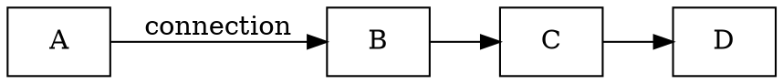
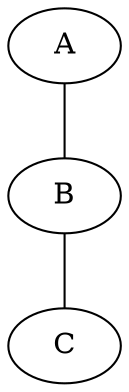
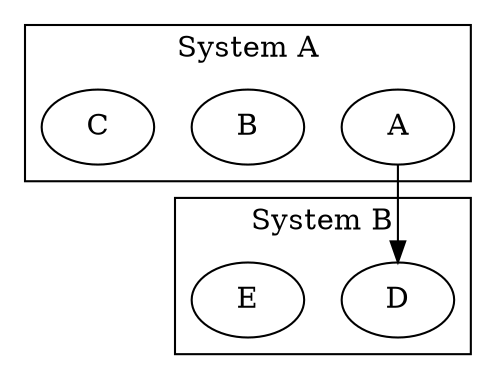
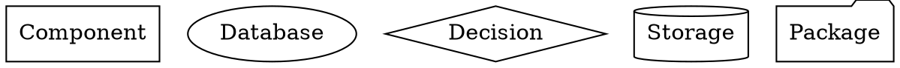

# Phase 3: GraphViz/DOT Output Support

## Goals

Add GraphViz DOT format generation as another output format, complementing PlantUML and Mermaid.

**Why GraphViz:**
- Industry standard for graph visualization
- Excellent automatic layout algorithms (dot, neato, fdp, circo)
- Used in many documentation and analysis tools
- Strong ecosystem (online renderers, converters)
- Clean text format for version control

## GraphViz/DOT Format Overview

### Supported Graph Types

**1. Directed Graph (digraph)**


**2. Undirected Graph (graph)**


**3. Subgraphs/Clusters**


**4. Node Shapes**


## Technical Implementation

### GraphViz Generator

```python
# diacea/generators/graphviz.py

from dataclasses import dataclass
from typing import TextIO
from ..ir.elements import Diagram, Element, Connection, Group, Shape
from ..ir.semantic import SemanticType
from .base import Generator


@dataclass
class GraphVizConfig:
    """Configuration for GraphViz generator."""

    direction: str = "LR"  # LR, TB, RL, BT
    graph_type: str = "digraph"  # digraph or graph
    node_shape_map: dict[SemanticType, str] = None
    use_clusters: bool = True
    cluster_prefix: str = "cluster_"
    indent: str = "    "

    def __post_init__(self):
        if self.node_shape_map is None:
            self.node_shape_map = {
                SemanticType.COMPONENT: "box",
                SemanticType.SYSTEM: "box3d",
                SemanticType.DATABASE: "cylinder",
                SemanticType.PERSON: "ellipse",
                SemanticType.QUEUE: "folder",
                SemanticType.CONTAINER: "component",
                SemanticType.SERVICE: "box",
                SemanticType.DECISION: "diamond",
                SemanticType.EXTERNAL: "octagon",
                SemanticType.STORAGE: "cylinder",
            }


class GraphVizGenerator(Generator):
    """Generate GraphViz DOT from IR."""

    def __init__(self, config: GraphVizConfig | None = None):
        self.config = config or GraphVizConfig()

    def generate(self, diagram: Diagram) -> str:
        """Generate complete DOT file."""
        lines = []

        # Header
        graph_type = self.config.graph_type
        lines.append(f"{graph_type} G {{")

        # Graph attributes
        lines.append(f"{self.config.indent}rankdir={self.config.direction};")
        lines.append(f"{self.config.indent}node [fontname=\"Helvetica\"];")
        lines.append(f"{self.config.indent}edge [fontname=\"Helvetica\"];")
        lines.append("")

        # Process groups as clusters
        if self.config.use_clusters:
            self._write_groups(diagram, lines)

        # Process standalone nodes
        self._write_nodes(diagram, lines)

        # Process connections
        self._write_connections(diagram, lines)

        # Footer
        lines.append("}")

        return "\n".join(lines)

    def _write_groups(self, diagram: Diagram, lines: list[str]) -> None:
        """Write groups as subgraph clusters."""
        groups = [elem for elem in diagram.elements if isinstance(elem, Group)]

        for group in groups:
            cluster_id = self._sanitize_id(group.id)
            indent = self.config.indent

            lines.append(f"{indent}subgraph {self.config.cluster_prefix}{cluster_id} {{")
            lines.append(f"{indent}{indent}label=\"{self._escape_label(group.label)}\";")

            # Add child nodes
            for child_id in group.children:
                child = diagram.get_element(child_id)
                if child and isinstance(child, Shape):
                    sanitized_id = self._sanitize_id(child.id)
                    shape = self._get_node_shape(child)
                    label = self._escape_label(child.label)
                    lines.append(
                        f"{indent}{indent}{sanitized_id} "
                        f"[shape={shape}, label=\"{label}\"];"
                    )

            lines.append(f"{indent}}}")
            lines.append("")

    def _write_nodes(self, diagram: Diagram, lines: list[str]) -> None:
        """Write standalone nodes."""
        indent = self.config.indent

        # Get nodes not in any group
        grouped_ids = set()
        for elem in diagram.elements:
            if isinstance(elem, Group):
                grouped_ids.update(elem.children)

        standalone_shapes = [
            elem for elem in diagram.elements
            if isinstance(elem, Shape) and elem.id not in grouped_ids
        ]

        for shape in standalone_shapes:
            sanitized_id = self._sanitize_id(shape.id)
            node_shape = self._get_node_shape(shape)
            label = self._escape_label(shape.label)

            # Add styling attributes
            attrs = [f"shape={node_shape}", f"label=\"{label}\""]

            if shape.style.fill_color:
                attrs.append(f"fillcolor=\"{shape.style.fill_color}\"")
                attrs.append("style=filled")

            if shape.style.stroke_color:
                attrs.append(f"color=\"{shape.style.stroke_color}\"")

            lines.append(f"{indent}{sanitized_id} [{', '.join(attrs)}];")

        if standalone_shapes:
            lines.append("")

    def _write_connections(self, diagram: Diagram, lines: list[str]) -> None:
        """Write connections/edges."""
        indent = self.config.indent
        arrow = "->" if self.config.graph_type == "digraph" else "--"

        connections = [elem for elem in diagram.elements if isinstance(elem, Connection)]

        for conn in connections:
            from_id = self._sanitize_id(conn.from_id)
            to_id = self._sanitize_id(conn.to_id)

            attrs = []
            if conn.label:
                attrs.append(f"label=\"{self._escape_label(conn.label)}\"")

            if conn.style.stroke_style == "dashed":
                attrs.append("style=dashed")

            if conn.connection_type == "bidirectional" and arrow == "->":
                attrs.append("dir=both")

            attr_str = f" [{', '.join(attrs)}]" if attrs else ""
            lines.append(f"{indent}{from_id} {arrow} {to_id}{attr_str};")

    def _get_node_shape(self, shape: Shape) -> str:
        """Determine GraphViz node shape."""
        # Check semantic type first
        if shape.semantic_type:
            dot_shape = self.config.node_shape_map.get(shape.semantic_type)
            if dot_shape:
                return dot_shape

        # Fallback to shape type
        shape_map = {
            "rectangle": "box",
            "ellipse": "ellipse",
            "diamond": "diamond",
            "text": "plaintext",
        }
        return shape_map.get(shape.shape_type, "box")

    def _sanitize_id(self, id_str: str) -> str:
        """Sanitize ID for DOT format."""
        # Replace invalid characters
        sanitized = id_str.replace("-", "_").replace(":", "_").replace(" ", "_")
        # Ensure starts with letter or underscore
        if sanitized and not (sanitized[0].isalpha() or sanitized[0] == "_"):
            sanitized = "n_" + sanitized
        return sanitized or "node"

    def _escape_label(self, label: str) -> str:
        """Escape label for DOT format."""
        return label.replace("\\", "\\\\").replace('"', '\\"').replace("\n", "\\n")


# Convenience functions
def generate_graphviz(diagram: Diagram, config: GraphVizConfig | None = None) -> str:
    """Generate GraphViz DOT from diagram IR."""
    generator = GraphVizGenerator(config)
    return generator.generate(diagram)


def generate_graphviz_to_file(
    diagram: Diagram,
    file: TextIO,
    config: GraphVizConfig | None = None,
) -> None:
    """Generate GraphViz DOT to file."""
    dot_content = generate_graphviz(diagram, config)
    file.write(dot_content)
```

### Auto-Detection Logic

```python
# In diacea/generators/graphviz.py

def detect_graph_type(diagram: Diagram) -> str:
    """Auto-detect whether to use digraph or graph."""
    connections = [elem for elem in diagram.elements if isinstance(elem, Connection)]

    if not connections:
        return "digraph"  # Default

    # Check if all connections are bidirectional
    bidirectional_count = sum(
        1 for conn in connections
        if conn.connection_type == "bidirectional"
    )

    # If majority are bidirectional, use undirected graph
    if bidirectional_count > len(connections) / 2:
        return "graph"

    return "digraph"


def detect_optimal_direction(diagram: Diagram) -> str:
    """Detect optimal rankdir based on diagram layout."""
    shapes = [elem for elem in diagram.elements if isinstance(elem, Shape)]

    if not shapes:
        return "LR"

    # Calculate bounding box
    min_x = min(s.position.x for s in shapes)
    max_x = max(s.position.x + s.size.width for s in shapes)
    min_y = min(s.position.y for s in shapes)
    max_y = max(s.position.y + s.size.height for s in shapes)

    width = max_x - min_x
    height = max_y - min_y

    # If wider than tall, use LR (left-right)
    if width > height * 1.5:
        return "LR"
    # If taller than wide, use TB (top-bottom)
    elif height > width * 1.5:
        return "TB"

    return "LR"  # Default
```

## CLI Integration

Update `diacea/cli.py`:

```python
parser.add_argument(
    '-f',
    '--format',
    default='c4',
    choices=['basic', 'c4', 'mermaid', 'graphviz'],  # Add graphviz
    help='Output format',
)

parser.add_argument(
    '--graphviz-direction',
    default=None,
    choices=['LR', 'TB', 'RL', 'BT'],
    help='GraphViz rankdir (default: auto-detect)',
)

# In main():
elif args.format == 'graphviz':
    from diacea.ir.parser import ExcalidrawParser
    from diacea.generators.graphviz import (
        generate_graphviz,
        detect_optimal_direction,
        GraphVizConfig,
    )

    parser = ExcalidrawParser()
    diagram = parser.parse(elements)

    direction = args.graphviz_direction or detect_optimal_direction(diagram)
    config = GraphVizConfig(direction=direction)
    output_content = generate_graphviz(diagram, config)
```

## New Tests

### Test Structure

```
tests/
├── test_graphviz.py          # GraphViz generator tests
├── data/
│   ├── simple_flow.json      # Simple flowchart
│   ├── clustered.json        # Diagram with groups
│   └── complex_arch.json     # Complex architecture
```

### Test Cases

```python
# tests/test_graphviz.py

import pytest
from diacea.ir.elements import (
    Diagram,
    Shape,
    Connection,
    Group,
    Point,
    Dimensions,
    Style,
)
from diacea.ir.semantic import SemanticType
from diacea.generators.graphviz import (
    generate_graphviz,
    GraphVizConfig,
    GraphVizGenerator,
    detect_graph_type,
    detect_optimal_direction,
)


class TestGraphVizBasics:
    """Test basic GraphViz generation."""

    def test_simple_diagram(self):
        """Test simple two-node diagram."""
        diagram = Diagram(
            id="test",
            elements=[
                Shape(
                    id="A",
                    label="Node A",
                    position=Point(0, 0),
                    size=Dimensions(100, 50),
                ),
                Shape(
                    id="B",
                    label="Node B",
                    position=Point(200, 0),
                    size=Dimensions(100, 50),
                ),
                Connection(id="conn1", from_id="A", to_id="B", label="connects"),
            ],
        )

        dot = generate_graphviz(diagram)

        assert "digraph G {" in dot
        assert "A [shape=box, label=\"Node A\"]" in dot
        assert "B [shape=box, label=\"Node B\"]" in dot
        assert 'A -> B [label="connects"]' in dot

    def test_node_shapes(self):
        """Test different node shapes."""
        diagram = Diagram(
            id="test",
            elements=[
                Shape(
                    id="db",
                    label="Database",
                    position=Point(0, 0),
                    size=Dimensions(100, 50),
                    semantic_type=SemanticType.DATABASE,
                ),
                Shape(
                    id="person",
                    label="User",
                    position=Point(200, 0),
                    size=Dimensions(100, 50),
                    semantic_type=SemanticType.PERSON,
                ),
            ],
        )

        dot = generate_graphviz(diagram)

        assert "shape=cylinder" in dot  # Database
        assert "shape=ellipse" in dot  # Person

    def test_clusters(self):
        """Test cluster/subgraph generation."""
        diagram = Diagram(
            id="test",
            elements=[
                Group(
                    id="system_a",
                    label="System A",
                    children=["comp1", "comp2"],
                    position=Point(0, 0),
                    size=Dimensions(300, 200),
                ),
                Shape(
                    id="comp1",
                    label="Component 1",
                    position=Point(10, 10),
                    size=Dimensions(100, 50),
                ),
                Shape(
                    id="comp2",
                    label="Component 2",
                    position=Point(150, 10),
                    size=Dimensions(100, 50),
                ),
            ],
        )

        dot = generate_graphviz(diagram)

        assert "subgraph cluster_system_a" in dot
        assert 'label="System A"' in dot
        assert "comp1" in dot
        assert "comp2" in dot

    def test_edge_styles(self):
        """Test different edge styles."""
        diagram = Diagram(
            id="test",
            elements=[
                Shape(id="A", label="A", position=Point(0, 0), size=Dimensions(50, 50)),
                Shape(id="B", label="B", position=Point(100, 0), size=Dimensions(50, 50)),
                Connection(
                    id="conn1",
                    from_id="A",
                    to_id="B",
                    style=Style(stroke_style="dashed"),
                ),
            ],
        )

        dot = generate_graphviz(diagram)

        assert "style=dashed" in dot

    def test_bidirectional_connection(self):
        """Test bidirectional arrows."""
        diagram = Diagram(
            id="test",
            elements=[
                Shape(id="A", label="A", position=Point(0, 0), size=Dimensions(50, 50)),
                Shape(id="B", label="B", position=Point(100, 0), size=Dimensions(50, 50)),
                Connection(
                    id="conn1",
                    from_id="A",
                    to_id="B",
                    connection_type="bidirectional",
                ),
            ],
        )

        dot = generate_graphviz(diagram)

        assert "dir=both" in dot

    def test_label_escaping(self):
        """Test special character escaping in labels."""
        diagram = Diagram(
            id="test",
            elements=[
                Shape(
                    id="A",
                    label='Node with "quotes" and \\ backslash',
                    position=Point(0, 0),
                    size=Dimensions(100, 50),
                ),
            ],
        )

        dot = generate_graphviz(diagram)

        assert '\\"' in dot  # Escaped quotes
        assert '\\\\' in dot  # Escaped backslash


class TestGraphVizConfig:
    """Test configuration options."""

    def test_direction_config(self):
        """Test rankdir configuration."""
        diagram = Diagram(
            id="test",
            elements=[
                Shape(id="A", label="A", position=Point(0, 0), size=Dimensions(50, 50)),
            ],
        )

        config = GraphVizConfig(direction="TB")
        dot = generate_graphviz(diagram, config)

        assert "rankdir=TB" in dot

    def test_undirected_graph(self):
        """Test undirected graph generation."""
        diagram = Diagram(
            id="test",
            elements=[
                Shape(id="A", label="A", position=Point(0, 0), size=Dimensions(50, 50)),
                Shape(id="B", label="B", position=Point(100, 0), size=Dimensions(50, 50)),
                Connection(id="conn1", from_id="A", to_id="B"),
            ],
        )

        config = GraphVizConfig(graph_type="graph")
        dot = generate_graphviz(diagram, config)

        assert "graph G {" in dot
        assert "A -- B" in dot  # Undirected edge


class TestGraphVizDetection:
    """Test auto-detection logic."""

    def test_detect_horizontal_layout(self):
        """Test detection of horizontal layout."""
        diagram = Diagram(
            id="test",
            elements=[
                Shape(id="A", label="A", position=Point(0, 0), size=Dimensions(100, 50)),
                Shape(id="B", label="B", position=Point(300, 0), size=Dimensions(100, 50)),
            ],
        )

        direction = detect_optimal_direction(diagram)
        assert direction == "LR"

    def test_detect_vertical_layout(self):
        """Test detection of vertical layout."""
        diagram = Diagram(
            id="test",
            elements=[
                Shape(id="A", label="A", position=Point(0, 0), size=Dimensions(100, 50)),
                Shape(id="B", label="B", position=Point(0, 300), size=Dimensions(100, 50)),
            ],
        )

        direction = detect_optimal_direction(diagram)
        assert direction == "TB"


class TestGraphVizIntegration:
    """Test integration with IR parser."""

    def test_end_to_end_excalidraw_to_graphviz(self, sample_excalidraw_data):
        """Test complete conversion from Excalidraw to GraphViz."""
        from diacea.ir.parser import ExcalidrawParser

        parser = ExcalidrawParser()
        diagram = parser.parse(sample_excalidraw_data['elements'])

        dot = generate_graphviz(diagram)

        assert "digraph G {" in dot
        assert dot.endswith("}")
        # Should have nodes and connections
        assert "->" in dot or "--" in dot
```

## Success Criteria

### Functional Requirements

- [ ] Generate valid GraphViz DOT syntax
- [ ] Support both directed and undirected graphs
- [ ] Handle subgraph clusters for groups
- [ ] Map semantic types to appropriate node shapes
- [ ] Support edge labels and styling
- [ ] Auto-detect optimal layout direction
- [ ] Escape special characters correctly
- [ ] Generate DOT that renders without errors

### Technical Requirements

- [ ] All tests pass (10+ test cases)
- [ ] Type hints throughout
- [ ] Follows existing generator pattern
- [ ] CLI integration working
- [ ] Documentation updated

### Quality Checks

- [ ] Generated DOT passes `dot -T svg` validation
- [ ] Complex diagrams render correctly
- [ ] No ID collision issues
- [ ] Handles empty diagrams gracefully

## Migration Notes

### Updating Existing Code

No breaking changes - purely additive feature.

### CLI Usage

```bash
# Generate GraphViz DOT
diacea -i diagram.json -f graphviz -o diagram.dot

# Specify direction
diacea -i diagram.json -f graphviz --graphviz-direction TB

# Render with GraphViz
diacea -i diagram.json -f graphviz | dot -T svg > diagram.svg
```

### Python API

```python
from diacea.ir.parser import ExcalidrawParser
from diacea.generators.graphviz import generate_graphviz, GraphVizConfig

parser = ExcalidrawParser()
diagram = parser.parse(elements)

# Basic usage
dot = generate_graphviz(diagram)

# Custom config
config = GraphVizConfig(direction="TB", graph_type="graph")
dot = generate_graphviz(diagram, config)
```

## Open Questions

1. **Color Mapping**: Should we map Excalidraw colors to GraphViz color names or use hex values?
   - Suggestion: Use hex for accuracy, with fallback to named colors

2. **Nested Clusters**: How deeply should we nest subgraphs?
   - Suggestion: Support 2 levels initially, extend if needed

3. **Layout Hints**: Should we preserve exact positions or let GraphViz optimize?
   - Suggestion: Let GraphViz optimize by default, add option for position preservation later

## Estimated Effort

- Implementation: 1.5 weeks
- Testing: 0.5 weeks
- Documentation: 0.5 weeks
- **Total: 2.5 weeks**

## Dependencies

- Phase 1 (Rich IR) must be complete
- No new external dependencies (GraphViz is for rendering, not required for generation)
